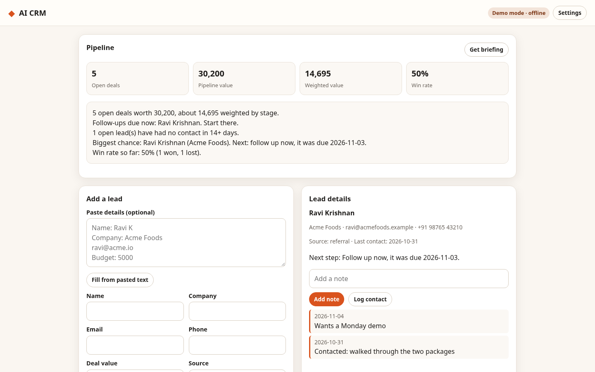

# AI CRM

A lightweight CRM that keeps leads, notes and follow-ups in order and tells you what to do next.



## Features

- Lead list with search, stage filter and sorting by value, follow-up date or name
- Stages from New to Won or Lost, with per-lead notes, contact log and follow-up dates
- Paste a lead's details (name, company, email, phone, budget) and fill the form in one click
- Pipeline numbers: open deals, pipeline value, stage-weighted value and win rate
- Rule-based next step for every lead, plus due and stale flags
- Demo briefing offline; live mode writes a briefing from your own model endpoint

## Quick start

```bash
git clone https://github.com/connectnived-lab/ai-crm
cd ai-crm
python3 -m http.server 8080
# open http://localhost:8080
```

Or open `index.html` in a browser. No build step and no runtime dependencies.

Local data lives in this browser (localStorage). Use "Add a lead" to start, or open the sample pipeline that loads on first visit.

## Demo and live modes

Demo mode is the default. It runs fully offline with deterministic logic and needs no key.

Live mode: open Settings, pick "Live", enter the base URL, key and model, then press "Get briefing". The model sees only the pipeline numbers and each lead's last two notes.

Settings are stored only in your browser's localStorage. They are never committed and are sent only to the endpoint you enter.

## Tests

```bash
npm test     # node --test unit tests; LLM calls are mocked through an injectable fetch
npm run e2e  # Playwright smoke test (python3 + local Chromium) at 390x844 and 1440x900
```

The e2e script serves the app locally, runs the main flow in demo mode and again against a mocked OpenAI-compatible endpoint, and checks that results appear, that there are no console errors, and that the page does not scroll horizontally. Unit tests for the core rules and the LLM/settings modules; Playwright end-to-end flows at both viewports.

## Limitations

- Data is kept in this browser only; there is no sync, login or multi-user access.
- Next steps come from simple stage rules, not a learned model.
- Live briefings are only as accurate as the endpoint you configure.
- No email sending, calendar or import from other CRMs.

## Project layout

```
src/core/   pure logic (leads, stages, insights, parsing, samples, LLM client, settings) - no DOM
src/ui/     DOM helpers and the settings panel
src/app.js  wiring between the UI and core
tests/unit  node:test suites
tests/e2e   Playwright smoke test
```

## Licence and credit

MIT License. Copyright (c) 2026 Nived NS.

Created and owned by Nived NS - https://github.com/connectnived-lab

Created and owned by Nived NS - https://github.com/connectnived-lab
